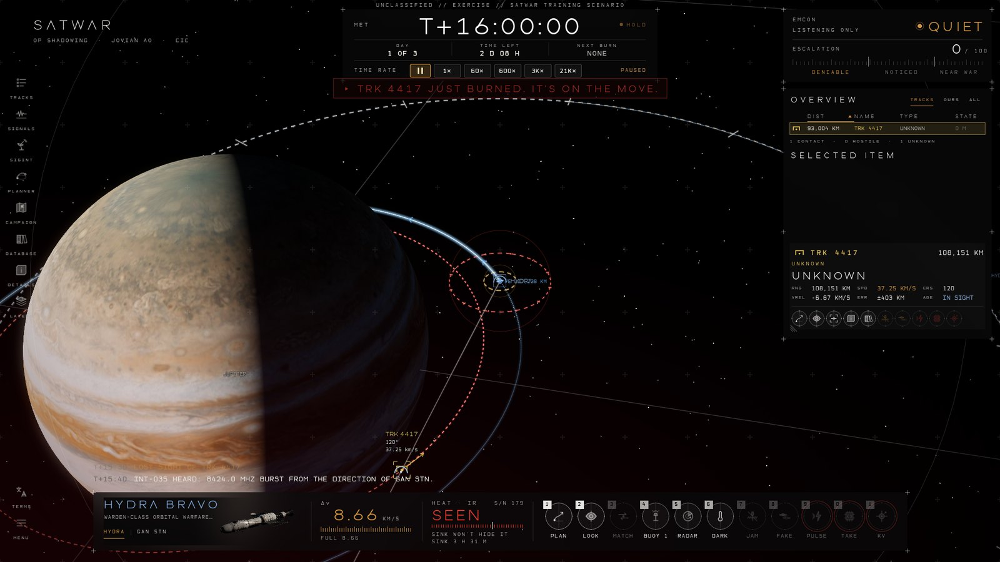

# SATWAR · Playtest downloads

An educational game of near-future stealth satellites and electronic warfare around Jupiter, built on real orbital mechanics and sensor physics. It runs in your browser.

| | |
|---|---|
| Play 0.7, THE SHADOWING | [game/](game/) |
| Play 0.1, the campaign map | [play/](play/) |
| Game as one HTML file | [satwar-0.1.html](satwar-0.1.html) |

This repository holds released builds only. © 2026 Kevin Williamson. All rights reserved.

## Licence

Copyright (c) 2026 Kevin Williamson. All rights reserved. See [LICENSE](LICENSE).
This repository holds only the public playtest page and builds, not the game's source code.
